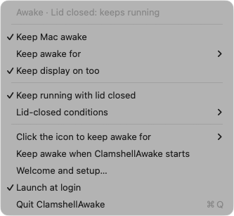
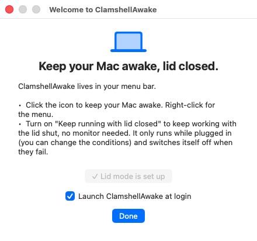

# ClamshellAwake

**Keep your Mac awake with the lid closed. No external monitor needed.**

ClamshellAwake is a tiny macOS menu-bar app that keeps your Mac awake and can keep it running **with the lid closed and no external monitor**. Made for long-running work you don't want to babysit: coding agents, builds, renders, downloads, a home server on a laptop.

Free, no dependencies, one Swift file.

<p align="center"></p>

---

## Features

**Keep awake**
- Left-click the icon to toggle, right-click for the menu
- Indefinitely, or for 5, 10, 15, 30 minutes, or 1, 2, 4, 5, 8 hours
- Optional "keep the display on too"
- Optional "keep awake when ClamshellAwake starts"

**Keep running with the lid closed**
- Works with no external monitor, keyboard, or mouse
- Conditions, all optional:
  - only when plugged in (on by default)
  - pause below a battery level (default 25%)
  - pause when the Mac is running hot
- Always switched back off when a condition fails, when you turn it off, or when ClamshellAwake quits or crashes

**Command line**, so scripts and AI agents can control it (see below)

The menu-bar icon tells you the state at a glance:

| Icon | Meaning |
|---|---|
| ☕ outline | sleeps normally |
| ☕ filled | keeping the Mac awake |
| 💻 laptop | lid mode active: keeps running with the lid closed |
| 💻 laptop with ⚠ | lid mode wanted but paused (on battery, low battery, or hot) |
| red dot | lid mode still needs its one-time approval |

## Install

Requires macOS 13 or later and a Swift toolchain (Xcode or the Command Line Tools).

```bash
git clone https://github.com/zivgin/clamshellawake.git
cd clamshellawake
./build-app.sh
open /Applications/ClamshellAwake.app
```

`build-app.sh` builds the app, installs it to `/Applications/ClamshellAwake.app`, and installs the `clamshellawake` command to `~/.local/bin` (add that to your `PATH` if it isn't already). To start it automatically, right-click the icon and pick **Launch at login**.

## First launch

On first launch ClamshellAwake shows a short welcome window where you can set up lid mode and turn on launch at login. You can open it again any time from the menu (**Welcome and setup…**).

<p align="center"></p>

## First-time approval for lid mode

The first time you turn on lid mode, ClamshellAwake asks for your administrator password **once**, from the red bar at the top of the menu or with `clamshellawake setup`. After that, lid mode switches on and off with no password.

## Command line

```bash
clamshellawake                          # show status
clamshellawake setup                    # one-time approval for lid mode

clamshellawake awake on                 # keep awake indefinitely
clamshellawake awake on 90              # keep awake for 90 minutes
clamshellawake awake off

clamshellawake lid on                   # keep running with the lid closed
clamshellawake lid off

clamshellawake display on|off           # keep the screen on while awake
clamshellawake only-on-power on|off     # lid mode only when plugged in
clamshellawake battery-floor 30         # pause lid mode below 30% (0 = no limit)
clamshellawake pause-when-hot on|off    # pause lid mode when the Mac runs hot
```

Every command prints the resulting status. If the app isn't running, the CLI starts it.

Exit codes: `0` ok, `2` bad usage, `3` lid mode isn't approved yet.

**From a script or a coding agent**: wrap a long job so the Mac can't sleep under it, then let it rest again:

```bash
clamshellawake awake on && clamshellawake lid on
./long-running-job.sh
clamshellawake lid off && clamshellawake awake off
```

## Safety

Lid mode is genuinely useful and genuinely easy to misuse:

- **Don't put a running Mac in a bag.** With no airflow it gets hot fast. The "pause when hot" condition is a backstop, not a license.
- Keep **only when plugged in** on unless you know you want battery operation.
- When you're done, turn lid mode off so the lid sleeps the Mac normally again.

## Uninstall

```bash
clamshellawake lid off
osascript -e 'tell application "ClamshellAwake" to quit'
rm -rf /Applications/ClamshellAwake.app ~/.local/bin/clamshellawake
sudo rm /etc/sudoers.d/clamshellawake
defaults delete com.zivgin.clamshellawake
```

## FAQ

**How do I keep my MacBook awake with the lid closed?**
Install ClamshellAwake, turn on **Lid mode** from the menu bar (or run `clamshellawake lid on`). Your Mac keeps running with the lid shut, no external monitor, keyboard or mouse needed.

**What is clamshell mode on a Mac?**
Clamshell mode is Apple's name for running a MacBook with the lid closed. Out of the box macOS only allows it with an external display and power connected. ClamshellAwake removes that requirement, safely and reversibly.

**How is this different from `caffeinate` or Amphetamine?**
`caffeinate` and most keep-awake apps stop the Mac from idling, but closing the lid still puts it to sleep. ClamshellAwake does both: keeps it awake and keeps it running with the lid closed, with battery, heat and time limits.

**Is it safe to run a MacBook with the lid closed?**
Yes, with limits. ClamshellAwake can pause lid mode below a battery level, when the Mac runs hot, or when unplugged, and always turns lid mode off when it quits or crashes. Keep the Mac on a hard, ventilated surface.

**Is it free?**
Yes. Free and open source (MIT), one Swift file, no account, no tracking.

## Contributing

Bug reports, feature requests, and pull requests are welcome, see [CONTRIBUTING.md](CONTRIBUTING.md).

## License

MIT, see [LICENSE](LICENSE).
